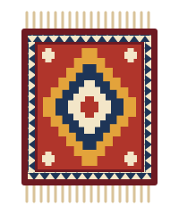
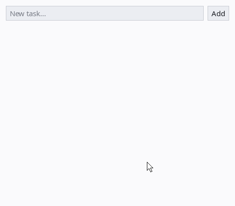
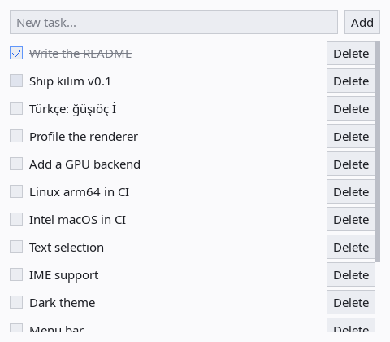

<p align="center">
  
</p>

<h1 align="center">kilim</h1>

<p align="center">
  A retained-mode GUI library for <a href="https://iyi.dev">iyi</a>, woven from scratch on Win32 + Direct2D on Windows and SDL3 elsewhere.
</p>

<p align="center">
  <a href="https://github.com/Tuntii/kilim/actions/workflows/ci.yml"></a>
  <a href="LICENSE"></a>
  
  
</p>

<p align="center">
  <a href="#quick-start">Quick start</a> ·
  <a href="#widgets">Widgets</a> ·
  <a href="#installation">Installation</a> ·
  <a href="ROADMAP.md">Roadmap</a> ·
  <a href="#contributing">Contributing</a>
</p>

<p align="center">
  
</p>

## Why kilim

- **Draws its own widgets.** kilim does not wrap the operating system's
  controls, so an app looks the same on Windows, Linux and macOS.
- **Small, declarative API.** You build a tree of widgets once and change
  them directly (`label.text = "..."`, `list.add(row)`), in the spirit of V's
  `ui`.
- **Plain iyi.** No `--crystal` and no Crystal standard library. On Windows
  kilim uses only the system's Win32, Direct2D and DirectWrite, so there are
  no DLLs to ship; on Linux and macOS the native dependencies are SDL3 and
  SDL3_ttf.
- **Unicode text that works.** Turkish and other non-ASCII text displays and
  edits correctly, with an embedded Noto Sans font. On Windows, characters it
  lacks (emoji, CJK) come from the system's font fallback.
- **Idle means idle.** kilim redraws only when something changes, and the
  layout follows live while you drag-resize the window.
- **Tested on three platforms.** Every commit runs the tests, a smoke test
  and a self-driving to-do app on Windows, Linux and macOS.

## Quick start

1. Install [iyi 0.20.0](#iyi-0200), and on Linux and macOS
   [SDL3 + SDL3_ttf](#sdl3-and-sdl3_ttf).
2. Add kilim to your `iyi.mod`:

   ```
   module example.com/app

   require github.com/tuntii/kilim v0.1.1
   ```

   or run `iyi get github.com/tuntii/kilim@v0.1.1`.
3. Write `main.iyi`:

   ```crystal
   import github.com/tuntii/kilim
   import github.com/tuntii/kilim/kilim/widget::{Widget}

   def main : Int32
     count = Kilim.label("0")
     n = 0
     inc = Kilim.button("Increment", -> { n += 1; count.text = n.to_s; nil })
     Kilim.window("Counter", 240, 120, Kilim.column([count, inc] of Widget, padding: 12, spacing: 8)).run
     0
   end

   exit main
   ```
4. Run it with `iyi run main.iyi`.

For a bigger example, see [`examples/todo.iyi`](examples/todo.iyi): a to-do
list with a textbox, buttons, checkboxes, scrolling and Turkish text.

<p align="center">
  
</p>

## Widgets

`import github.com/tuntii/kilim` gives you these builders under `Kilim`:

| Builder | What it is |
|---|---|
| `window(title, width, height, child)` | The app window; `.run` starts the event loop. |
| `column(children, padding:, spacing:, sizing:)` | Lays its children out top to bottom. |
| `row(children, padding:, spacing:, sizing:)` | Lays its children out left to right. |
| `label(text)` | Text; set `label.text = ...` to change it. |
| `button(text, on_click:, sizing:)` | A clickable button. Space and Enter work when it has focus. |
| `checkbox(text, checked:, on_change:, sizing:)` | A checkbox with a label. Checked items are drawn struck through. |
| `textbox(placeholder, on_change:, on_submit:, sizing:)` | A single-line text field with copy and paste. |
| `scroll(child, sizing:)` | A vertically scrolling viewport with a scrollbar. |

**Sizing.** Each child of a `row` or `column` sizes itself along that box's
direction:

- `Kilim.fit` (default) takes the size of its content.
- `Kilim.fixed(v)` takes `v` logical pixels.
- `Kilim.fill(weight)` shares the space that is left, in proportion to its
  weight.

Across the other direction, children stretch. A `textbox` with `fill` belongs
inside a `row`; inside a `column` it would grow vertically.

**Types.** The widget types live in submodules (`kilim/label`,
`kilim/button`, `kilim/box`, …). With only the package import, write them
with their qualified names (`Kilim::Widget::Widget`). For short names, also
import `github.com/tuntii/kilim/kilim/<name>::{Type}`, as the quick start does
for `Widget`.

**Keyboard.** Tab and Shift+Tab move focus. In a textbox, use the arrow keys,
Home/End, Backspace/Delete and Enter, plus Ctrl/Cmd+V to paste. Ctrl/Cmd+C
copies the whole text, because there is no selection yet.

## Installation

### iyi 0.20.0

kilim is pinned to iyi **0.20.0**. The official installers pin the version
with the `IYI_VERSION` environment variable (without it they install the
latest release). Fetch the installer from the same tag:

```powershell
# Windows (needs the Visual C++ build tools: "Desktop development with C++")
$env:IYI_VERSION = '0.20.0'
irm https://raw.githubusercontent.com/iyilang/iyi/v0.20.0/install.ps1 | iex
```

```sh
# Linux / macOS (needs cc)
curl -fsSL https://raw.githubusercontent.com/iyilang/iyi/v0.20.0/install.sh | IYI_VERSION=0.20.0 sh
```

### SDL3 and SDL3_ttf

The versions are pinned in `scripts/sdl-versions.txt`. On Windows SDL is only
needed for the SDL backend, which a program selects with `-Dsdl`
(`iyi run -Dsdl main.iyi`); the default Windows build uses the native backend.

| Platform | Setup |
|---|---|
| Windows | `. .\scripts\fetch-sdl.ps1` (the leading dot matters). It downloads the VC development packages into `vendor/windows/`, checks their SHA256, and sets `IYI_LIBRARY_PATH` and `PATH` for the current session. Ship `SDL3.dll` and `SDL3_ttf.dll` next to your exe. |
| Linux | `bash scripts/build-sdl-linux.sh` builds from source and installs to `/usr/local` (needs cmake, ninja and the X11 development packages; see `.github/workflows/ci.yml`). |
| macOS | `brew install sdl3 sdl3_ttf` and `export IYI_LIBRARY_PATH=$(brew --prefix)/lib`. |

iyi looks for `SDL3.lib` (`libSDL3` on Unix) in the directories listed in
`IYI_LIBRARY_PATH`. On Windows the DLLs must also be on `PATH` at run time.

### Working on kilim itself

```sh
iyi test                                            # core tests, no SDL needed
iyi run examples/todo.iyi                           # the to-do example
KILIM_SELFTEST=todo.bmp iyi run examples/todo.iyi   # hands-off acceptance test, writes todo.bmp
iyi run examples/smoke_win32.iyi                    # Windows: native backend end to end
iyi run -Dsdl examples/smoke.iyi                    # SDL backend end to end (-Dsdl only on Windows)
```

Benchmarks print Markdown tables (median and 95th percentile per case, for
100, 1,000 and 10,000 list rows). CI runs them on every platform and shows the
results in the job summary:

```sh
iyi run bench/core.iyi     # layout, draw traversal, hit-testing, typing; no SDL
iyi run bench/render.iyi   # one full frame in a real window, text included
```

To use a local clone from another project, add
`replace github.com/tuntii/kilim => ../kilim` to that project's `iyi.mod`. The
module path is lower-case because iyi does not allow upper-case paths.

In CI (`SDL_RENDER_DRIVER=software`), a run that cannot open a window is
retried with `SDL_VIDEO_DRIVER=offscreen`. Screenshots are uploaded as BMP
artifacts.

## Status

kilim is at **v0.1**: small, tested, and young. Not there yet:

- menu bar and multiple windows (one window per process);
- image widget, theme system (light theme only), animation, drag and drop;
- text selection, IME and multi-line text;
- accessibility (screen readers);
- mobile and web.

Every change still redraws the whole window, but rows scrolled out of view are
skipped, widget sizes are cached and rendered text is reused. On a Windows
desktop a full frame of the to-do list takes about 0.4 ms with 100 rows,
0.6 ms with 1,000 and 3 ms with 10,000 (19 ms, 184 ms and 1.8 s in v0.1.1).
Partial redraws come next in the [roadmap](ROADMAP.md). Progress is tracked on the
[project board](https://github.com/users/Tuntii/projects/4).

## Contributing

Issues labelled
[good first issue](https://github.com/Tuntii/kilim/issues?q=is%3Aissue+is%3Aopen+label%3A%22good+first+issue%22)
are a good place to start, for example Linux arm64 and Intel macOS support in
CI.

Commit messages follow [Conventional Commits](https://www.conventionalcommits.org/)
(`feat:`, `fix:`, `perf:`, `docs:`, `ci:`, `bench:` and so on), because releases
are cut from them: after CI passes on `master`,
[semantic-release](https://github.com/semantic-release/semantic-release) tags
the next version and publishes the release notes. `fix` and `perf` make a patch
release and `feat` a minor one; until 1.0 a breaking change (`feat!:` or a
`BREAKING CHANGE:` footer) also makes a minor release. Other types release
nothing. Pull requests are merged with a merge commit rather than squashed, so
each commit keeps its message.

<details>
<summary>Manual checklist (things CI cannot see)</summary>

CI runs without a visible display, so check these by hand on a real screen:

- Typing Turkish text from a real keyboard, and AltGr characters such as `@`.
- Scrolling with the mouse wheel, and the scroll direction on macOS with
  natural scrolling.
- Resizing the window by dragging: the layout should follow without freezing.
- CPU use while idle should be close to 0 %.
- On Windows at 125-150 % display scaling, is the UI physically too small?
  SDL may report a pixel density of 1 and put the scale in
  `SDL_GetWindowDisplayScale`.
- On AltGr layouts (Polish AltGr+C, Hungarian AltGr+V), the character is typed
  and copy/paste is not triggered.

</details>

## License

kilim is licensed under the [Apache License 2.0](LICENSE).

The embedded font is [Noto Sans](https://github.com/notofonts/latin-greek-cyrillic)
Regular (v2.015), under the SIL Open Font License 1.1 (`assets/fonts/OFL.txt`).
It is embedded in every built program (~620 KB).
